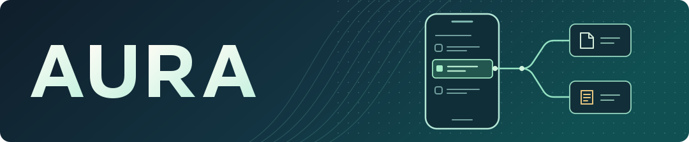
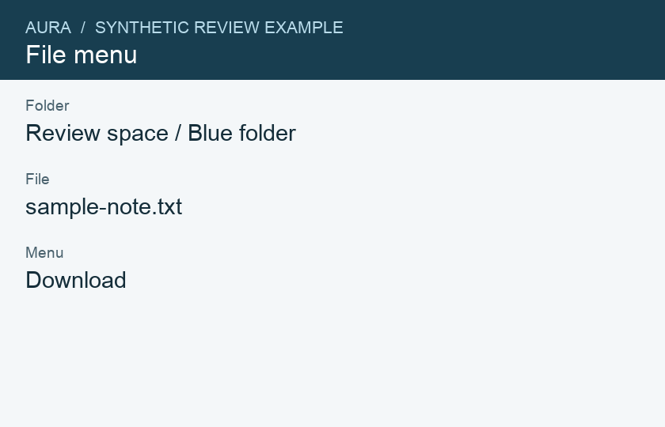
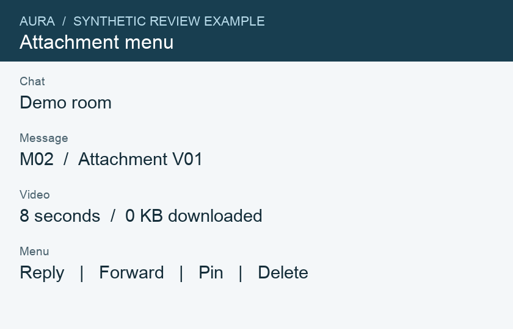

<h1 align="center">
  
</h1>
<p align="center">
  <strong>Acquisition through User Interfaces with Reviewable Artifacts and Outcomes</strong><br>
  <em>Forensic Science International: Digital Investigation</em>
</p>
<p align="center">
  <a href="#evaluation-dataset">Evaluation data</a> ·
  <a href="#quick-start">Run AURA</a> ·
  <a href="#supported-apps">Supported apps</a> ·
  <a href="#results">Review results</a> ·
  <a href="#citation">Cite</a> · <a href="#license">License</a>
</p>

AURA acquires data through Android app interfaces using profiles matched to the installed app version. It records both whether a procedure completed and what it acquired. A reviewer can trace a saved file back to its source or use the recorded UI actions and screen evidence to explain a partial result.

## Evaluation dataset

**228**&nbsp;runs · **76**&nbsp;configurations · **7**&nbsp;apps · **4**&nbsp;devices

Each configuration combined a device, app, method, and acquisition environment. Across three repetitions, all reported item counts matched in 71 of the 76 configurations. The devices were the Galaxy S21, Galaxy S8, Pixel 5, and Huawei P30 Lite.

| Download | Use it to |
| --- | --- |
| [**Run&nbsp;summaries**](public-evaluation/runs.csv) | Compare run conditions, duration, storage, and target and procedure outcomes. |
| [**Item counts**](public-evaluation/item-counts.csv) | Reproduce Table 8 using `reported_count`. Join to the run summaries on `run_id`. |

The [dataset guide](public-evaluation/README.md) defines the columns and explains the five Telegram counts that differ between the archived worksheet and the published table. The public CSVs are de-identified. Original chats, page contents, and attachments remain private.

## Quick start

### 1. Connect and inspect the device

For live acquisition, use **Python 3.13 or newer**, Android Debug Bridge (ADB), and an unlocked device you are authorized to examine. Enable USB debugging, authorize the host’s ADB connection, and sign in to the target app if it requires an account. The target UI must expose the elements needed to identify the data and permit screenshots. [Windows setup and Bluetooth receiver instructions (Korean)](START-WINDOWS-KO.md)

From the repository root, install AURA in a Python environment and check which installed app versions have matching profiles. If more than one device is connected, add `--serial DEVICE_SERIAL` to each AURA command.

```bash
python3 -m pip install -e .
adb devices -l
python3 -m aura inspect
```

`inspect` uses read-only ADB queries. An `exact` match means the installed app version has an eligible profile. A `nearest` match identifies a candidate to inspect, and `no_profile` means no eligible profile was found. Live acquisition requires an exact match.

### 2. Choose a scope and acquire

If Chrome has an exact match, try a device-only session. During `configure`, select the scope and confirm the authorization details. This writes a new configuration file. The second command starts acquisition.

```bash
python3 -m aura configure chrome --environment device_only --output chrome-config.json
python3 -m aura acquire chrome --config chrome-config.json
```

<details>
<summary><strong>Configure a session with several apps</strong></summary>

Pass the same app identifiers to both commands. Select the methods and environments you intend to run during configuration. Use a new output filename if a configuration already exists, and regenerate it if an app profile changes. [Example session configuration](docs/examples/session-config.example.json)

```bash
python3 -m aura configure telegram notion google_drive --output multi-app-config.json
python3 -m aura acquire telegram notion google_drive --config multi-app-config.json
```

</details>

### Acquisition flow

AURA finishes the planned **device-only** runs with airplane mode and Do Not Disturb enabled and Wi-Fi disabled. If **controlled-online** acquisition is selected, AURA then enables Wi-Fi, checks the connection, and records the SSID when available. The examiner manages any traffic restrictions at the access point.

At session end, including after an interruption, AURA attempts to restore Wi-Fi and notification settings and records the result. Airplane mode retains its final setting.

### Sequential repetitions

To repeat the same configuration three times on the connected device, run the command below. Each repetition produces a separate session. [Repetition guide (Korean)](docs/aura-repetitions-ko.md)

```bash
python3 tools/run_aura_repetitions.py chrome --config chrome-config.json --count 3
```

## Supported apps

**Materialize** reads information shown in the UI and uses app controls to save individual files where available. **Export** acquires the output of the app’s own export or backup function.

| App | CLI identifier | Methods | Data covered |
| --- | --- | --- | --- |
| Telegram | `telegram` | Materialize | Account information, chats, messages, media, and files |
| WhatsApp | `whatsapp` | Materialize, Export | Chats, messages, media, and chat exports |
| Notion | `notion` | Materialize, Export | Account and workspace information, pages, database entries, attachments, and exports |
| Notesnook | `notesnook` | Materialize, Export | Notes, revisions, attachments, trash, and exports |
| Google Chrome | `chrome` | Materialize | Account information, history, download-list entries, bookmarks, and recent tabs |
| Samsung Internet | `samsung_browser` (or `sbrowser`) | Materialize | History, download-list entries, saved-page entries, and bookmarks |
| Google Drive | `google_drive` | Materialize | My Drive folders, file metadata, activity, and downloadable files |

The [app profiles](profiles/apps) define which targets each version can acquire in each environment. The [System UI profiles](profiles/system_ui) handle device settings on Samsung, Huawei EMUI, and Google/generic Android.

<details>
<summary><strong>App-specific behavior and device changes</strong></summary>

- **Google Drive.** The supplied profiles collect listings and basic metadata in both environments. Activity and original file downloads run controlled-online. If a downloaded file could correspond to an earlier request in the same session, AURA preserves it and records the uncertain source as a partial result.
- **Notion.** Account, workspace, and page listings are available in both environments. Member information, page content, attachments, and exports are assigned to controlled-online acquisition. Profiles that use *Copy page contents* replace the device clipboard.
- **WhatsApp.** Materialize preserves document details with their messages and excludes document originals. Export uses a Bluetooth receiver. On Windows, run `python3 -m pip install -e ".[windows]"` and follow the [pairing instructions](START-WINDOWS-KO.md).
- **Browsers.** Download-list entries describe what the browser lists. When adjacent history screens overlap and the matching rows cannot be determined, AURA preserves the rows and flags the uncertainty for review.

</details>

## Results

A session records the plan and device state. Each executed app–method–environment combination produces a run package. Keep the session record, run ZIPs, and companion SHA-256 files together.

| Location | Contents |
| --- | --- |
| `runs/sessions/<session-id>/` | `session.json` and its hash. The record identifies the profiles, execution order, device settings, and run packages. |
| `runs/<run-id>/` | `acquisition.json` links items, attempts, and outcomes. `events.jsonl` records actions over time. `artifacts/` holds acquired data and screen evidence. |
| `runs/<run-id>.zip` | Packaged run with a `files.json` manifest of member paths, byte sizes, and SHA-256 hashes. The archive hash is in the adjacent `.zip.sha256` file. |

### Validation

Pass `session.json` to the standalone validator to check the package hashes, file sizes, and references between records. For a session with several runs, specify the run as well as the artifact or outcome ID. IDs are local to each run.

```bash
python3 tools/validate_aura_results.py "runs/sessions/SESSION_ID/session.json" \
  --run RUN_ID --trace artifact-000001
```

Replace `SESSION_ID`, `RUN_ID`, and the artifact ID with values from your session. A valid result confirms that the checked files and records are consistent. A partial acquisition can pass this check when the records account for its outcome.

### Try a provenance example

These two synthetic packages were prepared separately from the 228 study runs. Each can be reviewed offline with Python’s standard library or by following the records by hand.

- [Google Drive — trace a saved file](public-evaluation/examples/drive-preserved-file.zip). Follow `sample-note.txt` from the preserved file to its source folder and the action that downloaded it.
- [Telegram — explain a partial acquisition](public-evaluation/examples/telegram-partial-acquisition.zip). Follow the attachment record to its message and inspect the menu to see why the procedure completed without saving the original video.

<details>
<summary>View the simulated menus and run the traces</summary>

| Google Drive · File menu | Telegram · Attachment menu |
| --- | --- |
|  |  |

From the repository root, run the commands for the example you want to review.

**Google Drive**

```bash
python3 -m zipfile -e public-evaluation/examples/drive-preserved-file.zip runs/review-drive
python3 tools/validate_aura_results.py runs/review-drive/session.json --trace artifact-000003
```

**Telegram**

```bash
python3 -m zipfile -e public-evaluation/examples/telegram-partial-acquisition.zip runs/review-telegram
python3 tools/validate_aura_results.py runs/review-telegram/session.json --trace outcome-000001
```

</details>

### Tests

```bash
python3 -m pip install -e ".[test]"
python3 -m pytest -q --ignore=tests/test_latex_manuscript.py
python3 tools/audit_aura_profiles.py
```

### Repository layout

- [Acquisition code](src/aura) and [profile reference](profiles/README.md)
- [Evaluation runbook (Korean)](docs/aura-poc-evaluation-runbook-ko.md) and [validation history](docs/VALIDATION.md)
- [Review bundle guide (Korean)](docs/aura-review-bundle-ko.md) for comparing selected sessions

<a id="citation"></a>

## 📖 Citation

If you use AURA in research, please cite the following article and identify the software release or commit you used.

```bibtex
@article{Kim2026AURA,
  author  = {Kim, Junki and Park, Jungheum and Lee, Sangjin},
  title   = {{AURA}: A Framework for {UI}-Based Data Acquisition from {Android} Applications with Reviewable Provenance},
  journal = {Forensic Science International: Digital Investigation},
  year    = {2026},
  note    = {Accepted for publication on 21 November 2026}
}
```

Machine-readable citation metadata are available in [CITATION.cff](CITATION.cff).

<a id="license"></a>

## ⚖️ License

The AURA source code is licensed under the [Apache License 2.0](LICENSE). Third-party dependencies are governed by their respective licenses. Access to devices, accounts, and data requires separate authorization.
